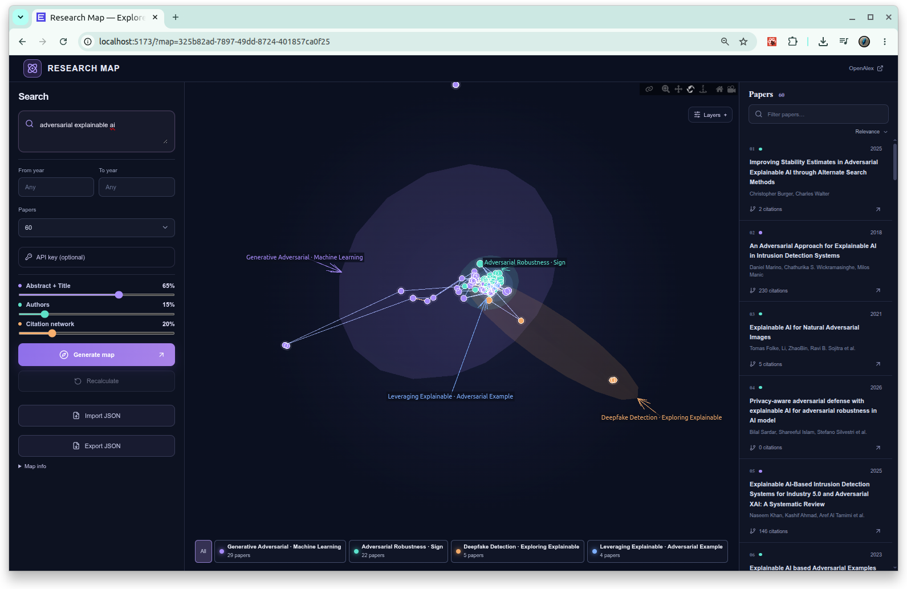

# [Research Map](https://github.com/europanite/research-map "Research Map")

[](https://github.com/europanite/research-map/actions/workflows/docker.yml)
[](https://github.com/europanite/research-map/actions/workflows/ci.yml)
[](https://github.com/europanite/research-map/actions/workflows/pages.yml)



 [PlayGround](https://europanite.github.io/research-map/)

Search research papers and build a 3D map.

## Quick Start

Requirements: 
- Docker Compose plugin 
- or Node 22+. 

The frontend performs **HTTPS `fetch` calls to `https://api.openalex.org/works` directly from the browser**.

### Node 

```bash
cd research-map
./scripts/start.sh
# http://localhost:5173
```

Direct Vite development without Docker:

```bash
cd frontend/app
npm ci
npm run dev
# http://localhost:5173
```

### Docker Compose 

```bash
# Start the browser-only development frontend (http://localhost:5173)
docker compose up -d --build frontend

# Follow frontend logs
docker compose logs -f frontend

# Stop development containers (preserves named volumes)
docker compose down
```

To run both test suites in sequence:

```bash
bash scripts/test.sh
```

## Tests

### Node

```bash
# Unit tests run offline with Node 22+; no OpenAlex requests:
cd frontend/app
npm run test:unit

# Full frontend build (requires npm dependencies):
npm ci
npm run build

# Docker: Python API tests + TypeScript offline unit tests + frontend build:
cd ../..
./scripts/test.sh
```

```bash
cd frontend/app
npm ci
VITE_BASE_PATH=/research-map/ npm run build
```

### Docker Compose 

```bash
# Frontend unit tests build
docker compose -f docker-compose.test.yml run --rm --build frontend_build

# Backend tests (isolated SQLite test database)
docker compose -f docker-compose.test.yml run --rm --build backend_test
```

An OpenAlex API key is **optional** for initial testing, but strongly recommended for extended queries and higher quotas. Enter **your own key** in the collapsible **OpenAlex API key (optional)** field in the app. It is kept in page memory only, is **not written to IndexedDB, localStorage, `.env`, or the backend**, and is sent **directly to OpenAlex in the request URL query string**. As with other URL-based API credentials, it is visible to the browser's network inspector, the OpenAlex provider, and any logging on the request path. **Never commit or hard-code a shared/private paid API key in the frontend**. A paid platform with a shared provider key must use a protected backend proxy.

### Portable maps, offline reuse

- **IndexedDB** stores the original metadata for a search for 24 hours, as well as each map snapshot and raw paper records needed for reweighting.
- Repeating the same query/years/limit within 24 hours reuses the local search cache, regardless of weights.
- If a fresh search fails and that query has an older cache, the app reuses the stale data and marks the fallback. If no cache exists, the error is shown.
- Local `?map=UUID` URL links reopen only on the **same browser profile/origin**. They **cannot be shared between devices** and are not cloud-hosted.
- **Export map JSON** saves the raw paper data and settings. **Import map JSON** reloads and recalculates the 3D map on another browser/device, without an application backend. JSON files contain paper metadata and abstracts; only import files you trust.
- Some private/locked-down browsers block IndexedDB; in that case memory-only fallback is temporary and lost when the page closes. Clearing browser site data also deletes cached maps.

### Visualization methodology

| Signal | Frontend algorithm | Caveat |
| --- | --- | --- |
| Title + abstract | Normalized TF-IDF of 1/2-grams, cosine similarity | Lexical, not a pretrained semantic embedding |
| Authors | Jaccard similarity of OpenAlex author IDs | Different coauthor teams may have zero overlap |
| Citations | 55% reference-list Jaccard (bibliographic coupling) + 45% direct citation | Works outside the sample contribute to coupling, but are not graph nodes |

Each positive similarity channel is normalized by its 90th percentile. Zero-availability channels are excluded from effective weights, scores are fused by the chosen weights, and distances are projected into 3D using **classical MDS (symmetric Jacobi eigendecomposition)**. Average-linkage grouping produces up to seven clusters; nearest similarity links and direct citation edges are rendered separately. Calculations run in a **Web Worker** so the React interface remains responsive.

**Interpretation:** proximity and clusters are exploratory patterns, **not causal influence, actual historical lineage, or scientifically validated relevance**. A sample of 20–120 papers and sparse citation metadata can distort distances. Abstracts and author identities are only as accurate as OpenAlex's source data.

## Provider quotas and limitations

OpenAlex generally requires a free API key for meaningful repeated queries and may restrict pagination or quota for anonymous traffic. This client requests a maximum **100 results per HTTP page**, and up to two pages for a 120-paper map; API errors (including 401/403, 402/429) appear in the UI. Current API terms, pricing and key requirements can change; see the official [API reference](https://help.openalex.org/api/), [paging](https://help.openalex.org/api/paging/) and [authentication](https://help.openalex.org/api/authentication/) documentation. Heavy production traffic may require a server-controlled API key and the appropriate OpenAlex plan.
